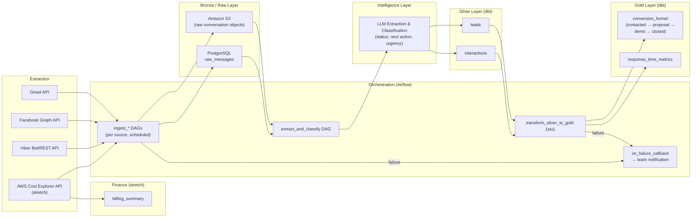

# SolNexus

A unified lead and client communication pipeline for SolTech EMR. SolNexus brings lead conversations from email, Facebook Messenger and Viber into one searchable system, so the team can track follow-ups and client history without a manually maintained spreadsheet.

Built by the NexusWorks team for CMSC 128/129.

## Goals

- Centralize lead and interaction data from multiple communication channels.
- Show which leads need follow-up today.
- Provide a searchable history of all leads and conversations.
- Automate ingestion, transformation and pipeline monitoring.
- Support future analytics and AI-assisted lead classification.

## Roadmap

### Phase 1: minimum finished product for this semester

- Automated Gmail ingestion with real synthetic API evidence.
- Upload of both sheets of the existing SolTech lead spreadsheet through separate format adapters, and download of the current lead list. Spreadsheet rows are clinic/lead records, not conversation exports.
- Manual clinic creation before any message arrives, plus basic in-app status and next-action-date correction.
- PostgreSQL bronze storage and dbt silver models for leads and interactions.
- Airflow orchestration with retries.
- FastAPI backend and React dashboard.
- Authentication for SolTech staff.

### Phase 2: expansion only after Phase 1 acceptance, as capacity allows

- Automated Facebook Page ingestion after an access and review-path decision, and Viber bot ingestion subject to access and conversation coverage.
- LLM-based extraction of lead status, next actions and urgency.
- Amazon S3 raw data lake and dbt gold analytics models.
- Conversion funnel and response-time reporting.
- Pipeline failure alerts, and optional finance tracking and daily digest features.

Sprint targets and ticket mapping are in the [implementation roadmap](docs/implementation_roadmap.md).

## Architecture

The pipeline follows a bronze/silver/gold (medallion) architecture. The diagram shows the full target system, including Phase 2 and stretch components.



The dashboard has two core views on one screen: **Due today** (leads to follow up today) above **All leads**.

See [System Architecture](docs/architecture.md) for details.

## Tech stack

| Layer | Tools |
|---|---|
| Frontend | React 19, TypeScript, Vite, Tailwind CSS, shadcn/ui |
| Backend | FastAPI (Python) |
| Data | PostgreSQL, dbt, Amazon S3 (Phase 2) |
| Pipeline | Apache Airflow |
| Integrations | Gmail API, Facebook Graph API, Viber API, AWS Cost Explorer |

## Getting started

### Prerequisites

- [Docker](https://docs.docker.com/get-docker/) with Docker Compose, to run the full stack
- [Node.js](https://nodejs.org/) 22 or later, only if you work on the frontend outside Docker

### Run the full stack

The Phase 1 scaffold runs as Docker Compose services: PostgreSQL, FastAPI, the React frontend and Apache Airflow (webserver and scheduler).

```bash
cp .env.example .env
docker compose up -d --build
docker compose run --rm --no-deps api alembic upgrade head
```

The last command creates or upgrades the database schema. Rerun it after pulling new migrations; see [Database schema and ownership](docs/database.md).

There is no sign-up page. Create a development staff account, using a synthetic email:

```bash
docker compose run --rm api python -m app.staff_account staff.one@example.test
```

See [Staff sign-in and sessions](docs/authentication.md) for session rules and cookie settings.

| Service | URL |
|---|---|
| React dashboard | http://localhost:5173 |
| FastAPI (`GET /health`) | http://localhost:8000/health |
| Airflow UI | http://localhost:8080 |
| PostgreSQL | `localhost:5433` |

The default Airflow login is `admin` / `admin`; override it in `.env`.

To stop everything:

```bash
docker compose down        # keep data
docker compose down -v     # also delete the Postgres volume
```

After pulling changes to `frontend/package.json`, refresh the frontend's packages with `docker compose run --rm web npm install`.

### Frontend only (no Docker)

The frontend ships with a mock API, so you can build screens before the backend endpoints exist. Create `frontend/.env.local` containing `VITE_USE_MOCKS=true` (git-ignored), then:

```bash
cd frontend
npm install
npm run dev
```

See the [frontend README](frontend/README.md) for scripts and conventions.

## Project structure

```
.
├── airflow/    Airflow image, DAGs and the Gmail connector (see airflow/README.md)
├── backend/    FastAPI app, Alembic migrations and dev seed
├── dbt/        dbt project (silver models; reads bronze and app as sources)
├── docker/     container init scripts (Postgres)
├── docs/       proposal, requirements, architecture, contracts, roadmap, wireframes
├── frontend/   React dashboard
└── compose.yaml
```

## Contributing

- Work is tracked in Jira project **SNX**. Pick up a ticket, then branch from `main` as `<type>/snx-<number>-short-name` (`feat`, `fix`, `docs` or `chore`).
- Write commits as [Conventional Commits](https://www.conventionalcommits.org/) with the ticket as scope, e.g. `feat(snx-54): add app shell`.
- Run the checks for the area you changed before opening a PR. Frontend: `npm run typecheck && npm run lint && npm run test`. Backend: `docker compose run --rm api pytest` (uses a separate `solnexus_test` database).
- Open a PR into `main`. It needs one approval from someone other than the last pusher.
- Use synthetic data only in fixtures, mocks, tests and screenshots. Real client data stays in the git-ignored `leads-data/` folder.

AI coding agents read [`AGENTS.md`](AGENTS.md) for the same rules plus project context.

## Documentation

- [SNX-21 Gmail OAuth findings and real synthetic API evidence](docs/spikes/SNX-21-gmail-oauth-findings.md) · [Docker probe runbook](backend/spikes/README.md)
- [Project Proposal](docs/project_proposal.md)
- [Software Requirements](docs/software_requirements.md)
- [System Architecture](docs/architecture.md)
- [Implementation Roadmap](docs/implementation_roadmap.md)
- [Phase 1 Data and API Contract](docs/contracts/phase1-data-api-v1.md)
- [Database Schema and Ownership](docs/database.md)
- [Staff Sign-in and Sessions](docs/authentication.md)
- [Wireframes](docs/wireframes)

## Team

JM Briz (Product Owner) · JP Salomeo (Scrum Master) · Luis Borbolla · Seth Caballero · Dan Guevara
