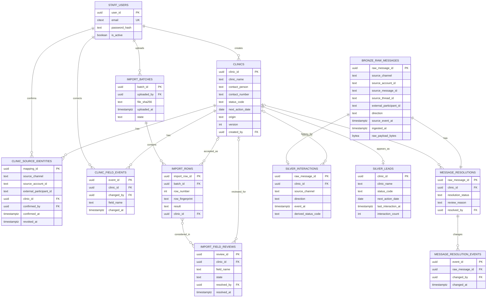
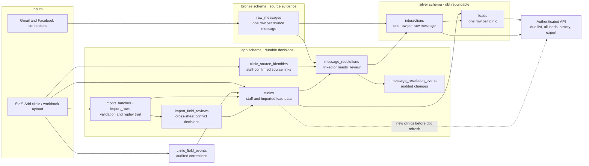

# Phase 1 ERD and database schema — review draft

Status: **draft for SNX-20 review**, not an approved migration. Read with [the proposed data/API contract](phase1-data-api-v1.md). Scope: Phase 1 (FR-01–FR-11, FR-19–FR-20, plus the requested basic status/date correction pending backlog amendment). Phase 2 adds Viber to the same message envelope and later adds enrichment and gold models; finance is outside this schema.

This design follows [the agreed identity contract](phase1-identity-v1.md). In particular, importing or manually creating a clinic gives it an internal ID, while a message remains unlinked until staff confirms its exact source identity. The app owns staff-entered clinic data and mappings; dbt owns rebuildable projections. No dbt run may replace the operational tables.

## ERD

Each box shows the fields that determine identity, linkage, or the dashboard view. `PK` means primary key, `FK` means foreign key, and `UK` means a unique key or index. Full columns and constraints remain in the table below.

`clinics`, clinic field events, import records, source mappings, and resolution decisions are **operational state** written through the API or ingestion service. `bronze.raw_messages` is append-only source evidence. `silver.leads` and `silver.interactions` are dbt-built read models. The dashboard reads silver plus any operational fields needed to show newly created or corrected clinics before the next dbt run; the API must provide a consistent merged view.

## Schema ownership and data flow

The dotted path represents the API's temporary read-through for a newly created clinic. It must use the same field precedence as `silver.leads`, so the list does not change meaning after a dbt refresh.

## Proposed PostgreSQL tables

Types and keys below are the intended migration contract once SNX-20 decisions are approved. Use `timestamptz` for instants, `date` for staff-selected next-action days, UUID primary keys, and `created_at`/`updated_at` where staff can edit a row. Do not store a password in clear text.

| Schema.table | Columns and keys | Constraints and purpose |
|---|---|---|
| `app.staff_users` | `user_id uuid PK`, `email citext UNIQUE`, `password_hash text`, `is_active boolean`, `created_at timestamptz` | Two designated staff accounts initially. `citext` requires its PostgreSQL extension; a normalized unique email is an alternative. |
| `app.clinics` | `clinic_id uuid PK`, `clinic_name text NOT NULL`, `contact_person text NULL`, `contact_number text NULL`, `email text NULL`, `region text NULL`, `province text NULL`, `municipality text NULL`, `address text NULL`, `status_code text NULL`, `next_action_date date NULL`, `next_step text NULL`, `point_person text NULL`, `discovery_source text NULL`, `origin text NOT NULL`, `version int NOT NULL`, `created_by uuid NULL FK staff_users`, `created_at`, `updated_at` | Stable operational clinic row for manual creation and accepted import from either workbook sheet. `origin` is `manual` or `import`. Null represents unknown, rather than inferred contact/status/date. Clinic name must be nonblank. `version` supports safe concurrent updates. Do **not** put a unique constraint on clinic name, phone, or email: those are candidate evidence, not identity. |
| `app.clinic_field_events` | `event_id uuid PK`, `clinic_id uuid FK clinics`, `field_name text`, `old_value jsonb`, `new_value jsonb`, `changed_by uuid FK staff_users`, `changed_at timestamptz`, `reason text NULL` | Append-only audit for explicit staff status/date corrections, including explicit null clears. Protect from dbt rebuilds and ordinary lead-list responses. |
| `app.import_batches` | `batch_id uuid PK`, `uploaded_by uuid FK staff_users`, `file_sha256 text`, `original_filename text`, `uploaded_at timestamptz`, `state text`, `created_clinic_count int`, `accepted_row_count int`, `needs_review_row_count int`, `rejected_row_count int`, `skipped_row_count int` | Audit of workbook uploads with clinic and row counts kept separate. Store file hash, not the private workbook blob. An identical hash may flag a replay but is not alone a clinic identity. |
| `app.import_rows` | `import_row_id uuid PK`, `batch_id uuid FK import_batches`, `sheet_name text`, `row_number int`, `row_fingerprint text`, `normalized_fields jsonb`, `validation_errors jsonb`, `result text`, `clinic_id uuid NULL FK clinics` | One result per attempted row. Unique `(batch_id, sheet_name, row_number)`. `result` is `accepted`, `needs_review`, `rejected`, or `skipped`; accepted rows link to a clinic, while other results have null `clinic_id` until review completes. Two accepted rows may link to the same newly created clinic. Fingerprint supports replay checks, not automatic cross-row merges. Raw client row values need an approved retention policy before storing them here. |
| `app.import_field_reviews` | `review_id uuid PK`, `clinic_id uuid NULL FK clinics`, `field_name text`, `candidate_import_row_ids uuid[]`, `state text`, `resolved_value jsonb NULL`, `resolved_by uuid NULL FK staff_users`, `resolved_at timestamptz NULL`, `resolution_reason text NULL` | Durable review of conflicting values from two or more import rows, including required clinic-name conflicts before a clinic exists. `state` distinguishes an unresolved null from a staff-selected null. Candidate row IDs refer to restricted import evidence; SNX-26 may use a junction table to enforce FKs. Identical-file replay reuses the recorded decision; a changed workbook with uncertain matches needs fresh review. |
| `app.clinic_source_identities` | `mapping_id uuid PK`, `source_channel text`, `source_account_id text`, `external_participant_id text`, `clinic_id uuid FK clinics`, `confirmed_by uuid FK staff_users`, `confirmed_at timestamptz`, `revoked_at timestamptz NULL`, `revoked_by uuid NULL FK staff_users`, `reason text NULL` | Append history; correcting a link revokes the old row and creates a new one. A partial unique index on `(source_channel, source_account_id, external_participant_id) WHERE revoked_at IS NULL` should enforce at most one active mapping. If historical/conflicting data bypasses this rule, resolution still returns `needs_review`. |
| `bronze.raw_messages` | `raw_message_id uuid PK`, `source_channel text`, `source_account_id text`, `source_message_id text`, `source_thread_id text NULL`, `external_participant_id text NULL`, `direction text`, `source_sender_id text NULL`, `source_recipient_ids jsonb`, `source_event_at timestamptz NULL`, `ingested_at timestamptz`, `raw_payload_bytes bytea`, `parsed_payload jsonb NULL` | Preserve the exact source response bytes as evidence; `jsonb` is a query aid and does not preserve original formatting. Unique `(source_channel, source_account_id, source_message_id)` for complete stable IDs; connectors must define a stable fallback or quarantine events without one. `direction` is `inbound` or `outbound`. Neither payload is rewritten by resolution or dbt. Index source thread and event time. |
| `app.message_resolutions` | `raw_message_id uuid PK FK bronze.raw_messages`, `clinic_id uuid NULL FK clinics`, `resolution_status text`, `review_reason text NULL`, `resolved_by uuid NULL FK staff_users`, `resolved_at timestamptz NULL`, `updated_at timestamptz` | Current association decision separate from bronze. `linked` requires a clinic; `needs_review` requires null clinic and one reason from the identity contract. |
| `app.message_resolution_events` | `event_id uuid PK`, `raw_message_id uuid FK message_resolutions`, `old_clinic_id uuid NULL`, `new_clinic_id uuid NULL`, `old_status text`, `new_status text`, `reason text`, `changed_by uuid NULL FK staff_users`, `job_run_id text NULL`, `changed_at timestamptz` | Append-only history for automated and staff resolution changes. A staff decision records `changed_by`; a system decision records `job_run_id`. Preserve an old mapping when corrected. |
| `silver.interactions` | `raw_message_id uuid PK`, `clinic_id uuid NULL`, `source_channel text`, `source_thread_id text NULL`, `direction text`, `event_at timestamptz NULL`, `ingested_at timestamptz`, `topic text NULL`, `derived_status_code text NULL`, `derived_next_action_date date NULL`, `parser_version text NULL` | dbt projection, one row per raw message. Retain unresolved interactions with null clinic for review; only linked rows appear in a clinic history. Rule parsing may suggest status, but cannot silently overwrite staff-entered clinic fields. dbt model tests check uniqueness and relationships. |
| `silver.leads` | `clinic_id uuid PK`, `clinic_name text`, `contact_person text NULL`, `contact_number text NULL`, `email text NULL`, `region text NULL`, `province text NULL`, `municipality text NULL`, `address text NULL`, `status_code text NULL`, `next_action_date date NULL`, `next_step text NULL`, `point_person text NULL`, `last_interaction_at timestamptz NULL`, `interaction_count int` | dbt projection with exactly one row per operational clinic, including clinics with zero messages and Ljs geographic fields. Current application values win; parsed values are suggestions only. This table is rebuildable, never an API write target. |

For `source_channel`, the Phase 1 allowed values are `gmail` and `facebook`; `viber` is added when Phase 2 is approved. Use check constraints or reference tables for fixed values. Prefer a migration tool for `app` and `bronze` DDL; dbt manages only `silver` model objects. A separate PostgreSQL database/schema for Airflow metadata must not be treated as app data.

## Required behavior and integrity checks

1. **Replay:** ingest the same complete source key and message ID twice; keep one bronze message and one silver interaction. Preserve the first raw payload. Record connector discrepancies separately instead of silently replacing evidence.
2. **Identity:** an unconfirmed sender yields a null clinic link and review reason. Only an active staff-confirmed exact `(channel, source account, participant)` mapping can link it, and conflicting evidence still requires review. No fuzzy name or imported contact value creates a mapping.
3. **Clinic durability:** every accepted import or manual creation persists in `app.clinics`, so rebuilding silver cannot erase it. A second workbook upload must neither duplicate a clinic nor overwrite edits made in the app; unresolved duplicate candidates need review.
4. **Due view:** calculate against one agreed business timezone and include due/overdue behavior only after SNX-20 confirms it. Closed and null-date handling, sort ties, and status list remain open.
5. **Access:** application queries and exports require authenticated staff access. Keep raw payloads out of lead-list exports and ordinary list responses; review access may retrieve them under staff authorization.

## Decisions to close in SNX-20 before migrations

| Decision | Why it blocks a final schema or API contract |
|---|---|
| Workbook mapping and scope | Both sheets are equally authoritative migration inputs. Headerless Ljs has confirmed A–G positions; Jacks D is a contact number despite its `Status` header and H is the real status source. On a staff-confirmed cross-sheet match, equal or complementary values can initialize fields; conflicting values remain unresolved for staff review, with no sheet priority. Decide Ljs H–I, Jacks H value normalization and B/J/K meanings, and blank/date parsing. Do not copy private row data into fixtures or docs. |
| Clinic candidate discovery | Staff confirmation is the identity rule, and later imports never overwrite app edits. Define and validate how the importer surfaces repeated or differently written rows as candidates, including a reconciliation review before production migration; a candidate is never an automatic merge. |
| Status and next-action ownership | Approve the proposed enum and due/closed behavior. Basic staff status/date correction was requested for Phase 1 on October 19; record the backlog and capacity change. Parser output remains a suggestion. |
| Message resolution lifecycle | The proposed contract re-evaluates earlier messages for the exact confirmed source identity; implement bounded replay, conflict review, and resolution audit in the dependent ticket. |
| Dashboard and import/export contracts | Set timezone, due/overdue and sorting rules, import limits/errors, export columns, API payloads and refresh timing. |

After approval, SNX-26 should implement operational/bronze migrations and constraints, SNX-28 should implement workbook parsing and replay protection, SNX-29 should create dbt projections, and SNX-30 should expose the agreed read model. This document is a design input to SNX-20, not a claim that its acceptance criteria are complete.
